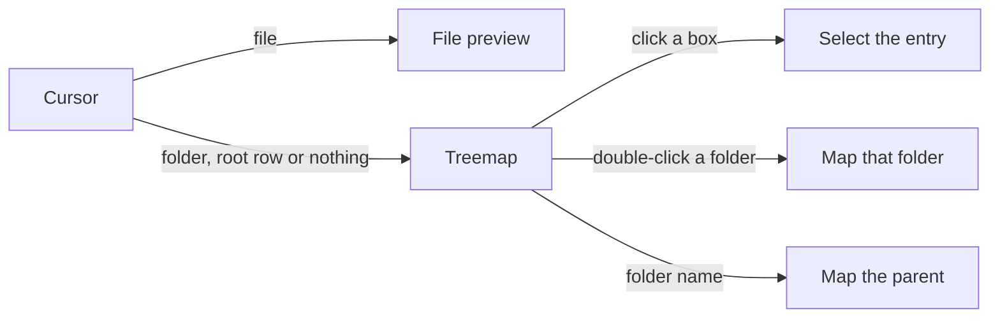

<h1 align="center">Claude Code Filetree</h1>

<p align="center">
  An IDE-style file tree for Claude Code that shows what Claude is doing and where in files
</p>

<p align="center">
  
  
  
  
</p>

<p align="center">
  
</p>

<table>
  <tr>
    <th>Preview</th>
    <th>Treemap</th>
    <th>Diff</th>
  </tr>
  <tr>
    <td></td>
    <td></td>
    <td></td>
  </tr>
</table>

> [!NOTE]
> filetree is a Claude Code **mod** and needs **Claude Code 2.1.306+**. It shows in the right sidebar, which in the terminal needs the fullscreen layout (`/tui fullscreen`) and a terminal at least 110 columns wide; the Desktop app docks it on its own. `/filetree` shows or hides it, and `/filetree open` opens it, or brings it forward from behind another tab, without hiding it. Tested on Linux, macOS and Windows; mods don't load in WSL sessions of the Desktop app.

---

## Installation

The repo is its own plugin marketplace. Run this in the terminal:

```bash
claude plugin marketplace add data-goblin/claude-code-filetree
claude plugin install filetree@claude-code-filetree
```

Or inside a Claude Code session:

```text
/plugin marketplace add data-goblin/claude-code-filetree
/plugin install filetree@claude-code-filetree
```

An install fails with `Unrecognized key: "options"` on Claude Code older than 2.1.287: run `claude update`, then install again.

## Features

- File tree of the cwd, or of a folder pinned with `/filetree <path>`, with search across unopened folders
- Git status per file and folder, line counts on changed files, and branch, upstream and ahead/behind in the header
- Claude's reads (purple), writes (orange) and commits (green) shimmer in the tree; collapsed folders open to show the file
- Git and GitHub commands Claude runs show as a status line at the bottom of the pane
- The selected file goes to Claude as context, and `@path` in a prompt reveals that file
- Right column cycles date, size and lines of code from the header button
- Split preview under or above the tree: highlighted code, rendered Markdown, images, video poster frames, and PDF and Word pages turned with `[` and `]`
- Treemap of the folder under the cursor in the same split, sized by bytes or by lines, with Claude's activity lit
- `d` shows the diff of a file or of every changed file in a folder, in the pane or in a tool you name
- Open files in their default app, an editor in a tmux or herdr pane, or any command
- Changes made outside Claude show at once on Linux through `inotifywait`
- Draws in the terminal's own palette, with Nerd Font, plain or text glyphs

  

### Preview and treemap

`p` or the header button shows the split. On a file it shows the file; on a folder, the root row or nothing it shows the treemap.





### Open in tmux or herdr


### Keys

With the tree focused:

```yaml
j / k:        move down / up; k on the first row selects the root
h / l:        collapse or go to parent / expand
o, Enter:     open a file or toggle a folder
s:            focus search
p:            show or hide the preview or treemap
f / b:        scroll the preview a page
"[ / ]":      previous / next page of a PDF or Word document
d:            diff of the entry under the cursor
y / Y:        copy the relative / absolute path
"?":          show the shortcuts in the footer for 10 seconds
Space:        Quick Look on macOS
```


Resize the pane with the mouse or the `pane:grow` and `pane:shrink` keybindings.

## Settings

All settings are in `/config` under filetree, each with its own description there.

```yaml
Claude activity:  reads and writes | writes | reads | none
Follow Claude:    on | off
Open at start:    on | off
Right column:     date | age | size | loc
Hints:            on | off
Search spacing:   on | off
Shortcut row:     auto | always | off
Open with:        empty | editor | preview | a command with {path} and {dir}
Binary files:     Open with | default app
Edit with:        empty | a command with {path} and {line}
Diff with:        empty | a command such as "hunk diff --" or "lazygit -f"
Terminal target:  auto | pane right | pane below | tab | workspace
Ignore:           names to hide, such as ".cache .tmp"
Preview pane:     bottom | top
Treemap:          auto | image | cells | off
Palette:          key=#hex pairs over the terminal colors
Glyphs:           auto | nerd | plain | text
```


## Requirements

```yaml
required:  Claude Code 2.1.306 or newer, git
optional:
  inotifywait:            live updates on Linux (inotify-tools)
  magick or ffmpeg:       images other than PNG, video frames
  pdftoppm or gs:         PDF pages
  soffice:                Word and office pages
  pandoc, pdftotext:      document text in tmux, herdr and other terminals
  tmux or herdr:          an editor or diff tool in a new pane
  Nerd Fonts 3.2+:        icons for Glyphs auto, which draws plain Unicode without one or with an older one
pictures:  Ghostty or kitty, outside tmux and herdr, on Linux and macOS
```

## Considerations

- The Desktop app has no split preview or treemap
- GIFs and videos show one still frame
- Windows sizes folders through file listings, and the treemap draws one level
- Row clicks need herdr 0.9.1 or later; run `herdr update`

## Contributing

Turn on the pre-commit hook once per clone; it runs `claude plugin validate` and the plugin tests before each commit that touches the plugin:

```bash
git config core.hooksPath .githooks
```

The same checks run on macOS, Windows and Linux in CI on every push that touches the plugin.

## License

[MIT](LICENSE). The treemap labels use glyphs from [Terminus Font](https://terminus-font.sourceforge.net/) by Dimitar Zhekov (Lat2-Terminus16, SIL Open Font License 1.1).

*This project is inspired by my Omarchy app [FileBlade](https://github.com/data-goblin/fileblade)*
