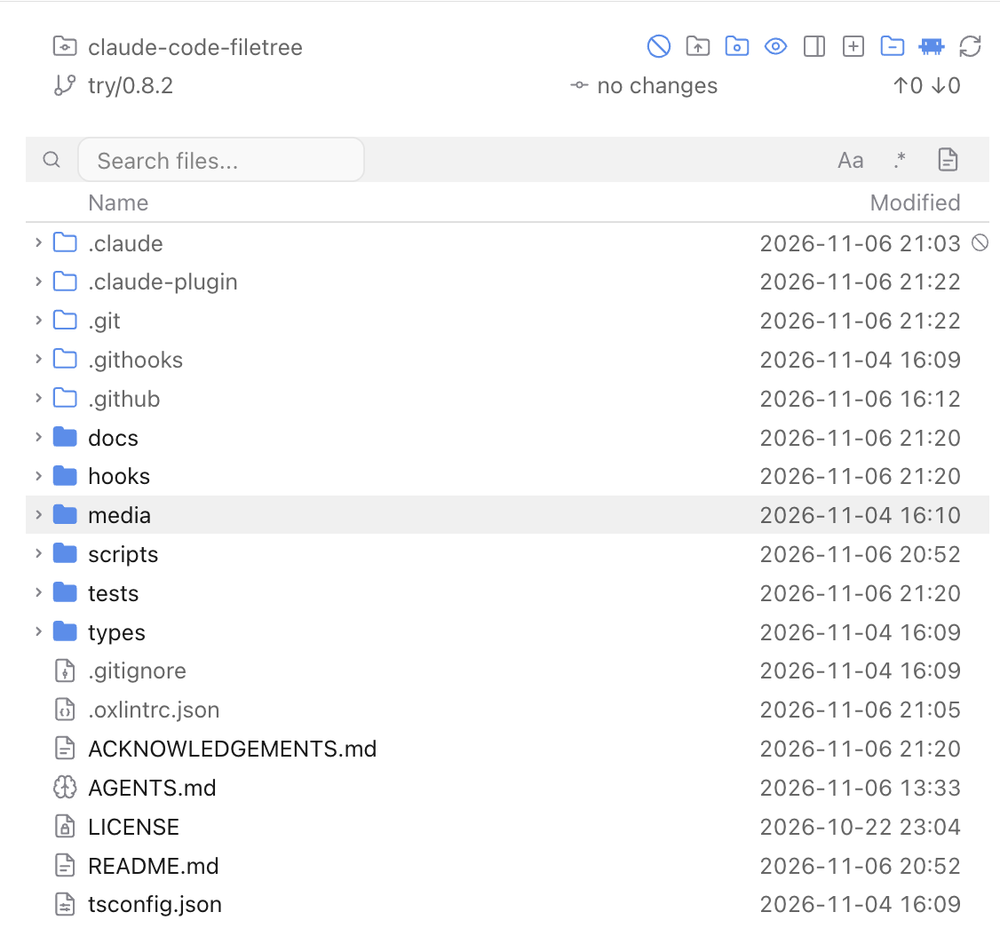
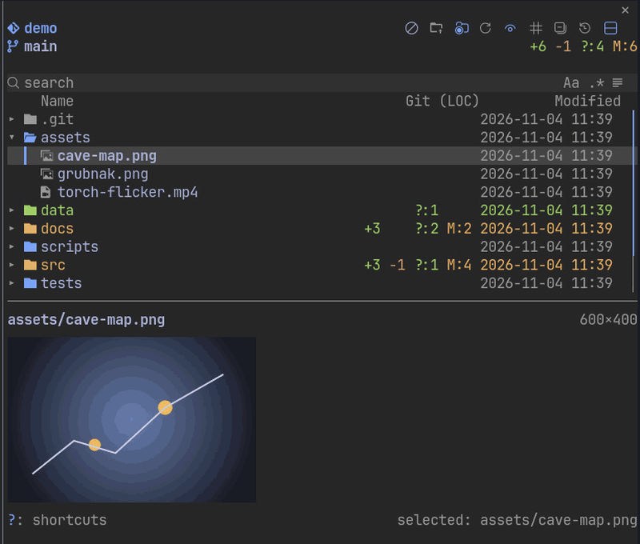

<h1 align="center">Claude Code Filetree</h1>

<p align="center">
  An IDE-style file tree for Claude Code that shows what Claude is doing and where in files
</p>

<p align="center">
  
  
  
  
</p>

<details open>
<summary><b>Claude Code CLI</b></summary>

<p align="center">
  
</p>

</details>

<details>
<summary><b>Claude Code in Desktop App</b></summary>

<p align="center">
  
</p>

</details>

**Key features:**

* Show/nav all files in a directory (with support for Git status, nvim bindings)
* Animations show where Claude is reading/working
* Keyboard shortcuts:
   * Nav directories with `z` (zoxide-like)
   * Search with `s` or `i` (in highlighted folder) or `q` (in file contents)
   * Diff files with `d` or all changed files in a folder
* Terminal-first features: File previews, directory size treemap, and more

---

## Installation

The repo is its own plugin marketplace. Run this in the terminal:

```bash
claude plugin marketplace add data-goblin/claude-code-filetree
claude plugin install filetree@claude-code-filetree
```

Or inside a Claude Code session:

```text
/plugin marketplace add data-goblin/claude-code-filetree
/plugin install filetree@claude-code-filetree
```

An install fails with `Unrecognized key: "options"` on Claude Code older than 2.1.287: run `claude update`, then install again.

## Features

- File tree of the cwd or a pinned folder, with Git, size, line count and date columns ([tree](docs/tree.md))
- Collapse all, and expand all up to three levels deep ([tree](docs/tree.md))
- Symlink arrows, a brain on agent instruction files, and Nerd Font, plain or text glyphs ([tree](docs/tree.md))
- Search by name across unopened folders, by case or regular expression, scoped to one folder ([search](docs/search.md))
- Search inside files with `git grep` or `grep -r`, and open a match at its line ([search](docs/search.md))
- Jump to any folder zoxide style with `z` ([search](docs/search.md))
- Git status per file and folder, line counts on changed files, and the branch with ahead and behind ([git](docs/git.md))
- Git and GitHub commands Claude runs show as a status line ([git](docs/git.md))
- Claude's reads, writes and commits shimmer in the tree, and auto-collapse closes the folders it opened ([activity](docs/activity.md))
- The Activity shimmer setting turns the shimmer off in every session; the Clawd button in the Desktop app header flips it ([activity](docs/activity.md))
- File references with a line in Claude's replies become links to that line ([activity](docs/activity.md))
- Follow work moves the session to the repo Claude works in ([activity](docs/activity.md))
- IDE-style multi-select; the shaded rows go to Claude as context: the selected row, or up to 100 marked rows ([context](docs/context.md)):
  - click selects one row and clears the marks
  - with rows marked, j / k move only the cursor, and `v` marks or unmarks the row under it
  - shift+click marks the range from the last click or j / k move, in tree order
  - ctrl+click marks or unmarks one row without opening it; alt+click on macOS
  - double-click or Enter opens a file
  - the clear selection button clears every marked and selected row
  - marked rows show the selection background; `y`, `Y` and `u` copy the shaded rows
  - with rows marked, the row under the cursor shows an accent tint in the Desktop app and the accent cursor mark in the terminal
- Split preview of code, Markdown, images, video frames, PDF and Word pages ([preview and treemap](docs/preview-treemap.md))
- Treemap of a folder by bytes or lines, with Claude's activity lit ([preview and treemap](docs/preview-treemap.md))
- Diff of a file or every changed file in a folder, in the pane or your diff tool ([diff](docs/diff.md))
- Open files in their default app, an editor in a tmux or herdr pane, or any command ([open](docs/open.md))
- Guard files and folders from Claude's edits, and see files written outside the repo ([guards](docs/guards.md))
- Keyboard-driven: vim-style moves, a shortcuts overlay, and alt+l / alt+h in the terminal ([keys](docs/keys.md))
- `/filetree` commands and where the pane shows in the terminal and the Desktop app ([sidebar](docs/sidebar.md))




## Settings

All settings are in `/config` under filetree, each with its own description there.

```yaml
Claude activity:  reads and writes | writes | reads | none
Activity shimmer: on | off
Follow Claude:    on | off
Jump moves Claude: tree and Claude | tree
Follow work:      on | off
Open at start:    on | off
Focus on open:    on | off
Right column:     date | age | size | loc | files
Date format:      year-month-day | day-month | month-day
Clock:            24h | 12h
Long file:        500 | a line count | off
Remote branch:    off | on
Hints:            on | off
Search spacing:   on | off
Column headers:   on | off
Auto-collapse:    off | on
Shortcuts:        auto | always | off
Open with:        empty | editor | preview | a command with {path} and {dir}
Binary files:     Open with | default app
Edit with:        empty | a command with {path} and {line}
Diff with:        empty | a command such as "hunk diff --" or "lazygit -f"
Diff groups:      folder | kind | off
Terminal target:  auto | pane right | pane below | tab | workspace
Ignore:           names to hide, such as ".cache .tmp"
Preview pane:     bottom | top
Treemap:          auto | image | cells | off
Palette:          key=#hex pairs over the terminal colors
Glyphs:           auto | nerd | plain | text
```

Follow work is described in [Claude activity](docs/activity.md).

## Requirements

```yaml
required:  Claude Code 2.1.306 or newer, git
optional:
  inotifywait:            live updates on Linux (inotify-tools)
  magick or ffmpeg:       images other than PNG, video frames
  pdftoppm or gs:         PDF pages
  soffice:                Word and office pages
  pandoc, pdftotext:      document text in tmux, herdr and other terminals
  tmux or herdr:          an editor or diff tool in a new pane
  Nerd Fonts 3.2+:        icons for Glyphs auto, which draws plain Unicode without one or with an older one
pictures:  Ghostty or kitty, outside tmux and herdr, on Linux and macOS
```

## Considerations

- The Desktop app has no split preview or treemap
- The Desktop app shimmers at most four rows at once; more lit rows show in their color without the shimmer, while the terminal shimmers them all. If the pane still floods, the Clawd button in the header or the Activity shimmer setting turns the shimmer off
- The Desktop app draws at most 150 rows around the cursor, and fewer when rows are deep, have long paths or show git changes; a note counts the rows it leaves out
- GIFs and videos show one still frame
- Windows sizes folders through file listings, and the treemap draws one level
- Row clicks need herdr 0.9.1 or later; run `herdr update`

## Contributing

Open pull requests against a release branch, not `main`:

- Fixes: the patch branch, such as `release/0.8.2`
- Features: the minor branch, such as `release/0.9.0`

Keep the version of that branch.

Turn on the git hooks once per clone. The pre-commit hook runs the fast checks in seconds: grep rules, types, oxlint, and `claude plugin validate` when the manifests change. The pre-push hook checks the version against the release branch and runs the plugin tests:

```bash
git config core.hooksPath .githooks
```

The same checks run on macOS, Windows and Linux in CI on every push that touches the plugin.

## License

[MIT](LICENSE). The treemap labels use glyphs from [Terminus Font](https://terminus-font.sourceforge.net/) by Dimitar Zhekov (Lat2-Terminus16, SIL Open Font License 1.1).

*This project is inspired by my Omarchy app [FileBlade](https://github.com/data-goblin/fileblade)*
