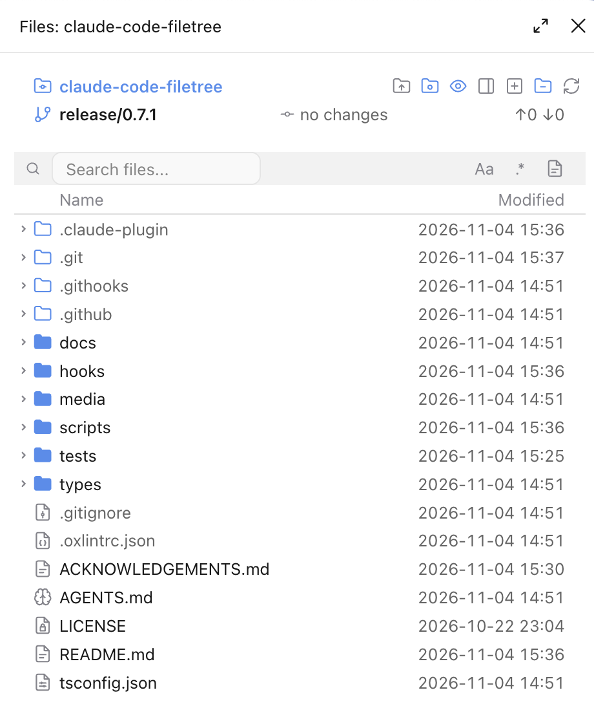

<h1 align="center">Claude Code Filetree</h1>

<p align="center">
  An IDE-style file tree for Claude Code that shows what Claude is doing and where in files
</p>

<p align="center">
  
  
  
  
</p>

<details open>
<summary><b>Claude Code CLI</b></summary>

<p align="center">
  
</p>

</details>

<details>
<summary><b>Claude Code in Desktop App</b></summary>

<p align="center">
  
</p>

</details>

**Key features:**

* Show/nav all files in a directory (with support for Git status, nvim bindings)
* Animations show where Claude is reading/working
* Keyboard shortcuts:
   * Nav directories with `z` (zoxide-like)
   * Search with `s` or `i` (in highlighted folder) or `q` (in file contents)
   * Diff files with `d` or all changed files in a folder
* Terminal-first features: File previews, directory size treemap, and more

---

## Installation

The repo is its own plugin marketplace. Run this in the terminal:

```bash
claude plugin marketplace add data-goblin/claude-code-filetree
claude plugin install filetree@claude-code-filetree
```

Or inside a Claude Code session:

```text
/plugin marketplace add data-goblin/claude-code-filetree
/plugin install filetree@claude-code-filetree
```

An install fails with `Unrecognized key: "options"` on Claude Code older than 2.1.287: run `claude update`, then install again.

## Features

- [Sidebar](docs/sidebar.md): where the pane shows and the `/filetree` commands
- [File tree](docs/tree.md): columns, collapse and expand all, symlinks, glyphs
- [Search](docs/search.md): names, file contents and zoxide-style jumps
- [Git](docs/git.md): status, branch row and Claude's git commands
- [Claude activity](docs/activity.md): shimmer, reply links, auto-collapse and follow work
- [Context for Claude](docs/context.md): the selected file, marks and `@path`
- [Preview and treemap](docs/preview-treemap.md): code, Markdown, images, PDFs and folder sizes
- [Diff](docs/diff.md): a file or every changed file in a folder
- [Open files](docs/open.md): default app, editor, tmux and herdr
- [Guards and outside writes](docs/guards.md): keep Claude's edits off files, and see writes outside the repo
- [Keys](docs/keys.md): every key and `/filetree keys`

## Settings

All settings are in `/config` under filetree, each with its own description there.

```yaml
Claude activity:  reads and writes | writes | reads | none
Follow Claude:    on | off
Jump moves Claude: tree and Claude | tree
Follow work:      on | off
Open at start:    on | off
Focus on open:    on | off
Right column:     date | age | size | loc | files
Long file:        500 | a line count | off
Remote branch:    off | on
Hints:            on | off
Search spacing:   on | off
Column headers:   on | off
Auto-collapse:    off | on
Shortcuts:        auto | always | off
Open with:        empty | editor | preview | a command with {path} and {dir}
Binary files:     Open with | default app
Edit with:        empty | a command with {path} and {line}
Diff with:        empty | a command such as "hunk diff --" or "lazygit -f"
Diff groups:      folder | kind | off
Terminal target:  auto | pane right | pane below | tab | workspace
Ignore:           names to hide, such as ".cache .tmp"
Preview pane:     bottom | top
Treemap:          auto | image | cells | off
Palette:          key=#hex pairs over the terminal colors
Glyphs:           auto | nerd | plain | text
```

Follow work is described in [Claude activity](docs/activity.md).

## Requirements

```yaml
required:  Claude Code 2.1.306 or newer, git
optional:
  inotifywait:            live updates on Linux (inotify-tools)
  magick or ffmpeg:       images other than PNG, video frames
  pdftoppm or gs:         PDF pages
  soffice:                Word and office pages
  pandoc, pdftotext:      document text in tmux, herdr and other terminals
  tmux or herdr:          an editor or diff tool in a new pane
  Nerd Fonts 3.2+:        icons for Glyphs auto, which draws plain Unicode without one or with an older one
pictures:  Ghostty or kitty, outside tmux and herdr, on Linux and macOS
```

## Considerations

- The Desktop app has no split preview or treemap
- GIFs and videos show one still frame
- Windows sizes folders through file listings, and the treemap draws one level
- Row clicks need herdr 0.9.1 or later; run `herdr update`

## Contributing

Open pull requests against a release branch, not `main`:

- Fixes: the patch branch, such as `release/0.7.1`
- Features: the minor branch, such as `release/0.8.0`

Keep the version of that branch.

Turn on the git hooks once per clone. The pre-commit hook runs the fast checks in seconds: grep rules, types, oxlint, and `claude plugin validate` when the manifests change. The pre-push hook checks the version against the release branch and runs the plugin tests:

```bash
git config core.hooksPath .githooks
```

The same checks run on macOS, Windows and Linux in CI on every push that touches the plugin.

## License

[MIT](LICENSE). The treemap labels use glyphs from [Terminus Font](https://terminus-font.sourceforge.net/) by Dimitar Zhekov (Lat2-Terminus16, SIL Open Font License 1.1).

*This project is inspired by my Omarchy app [FileBlade](https://github.com/data-goblin/fileblade)*
