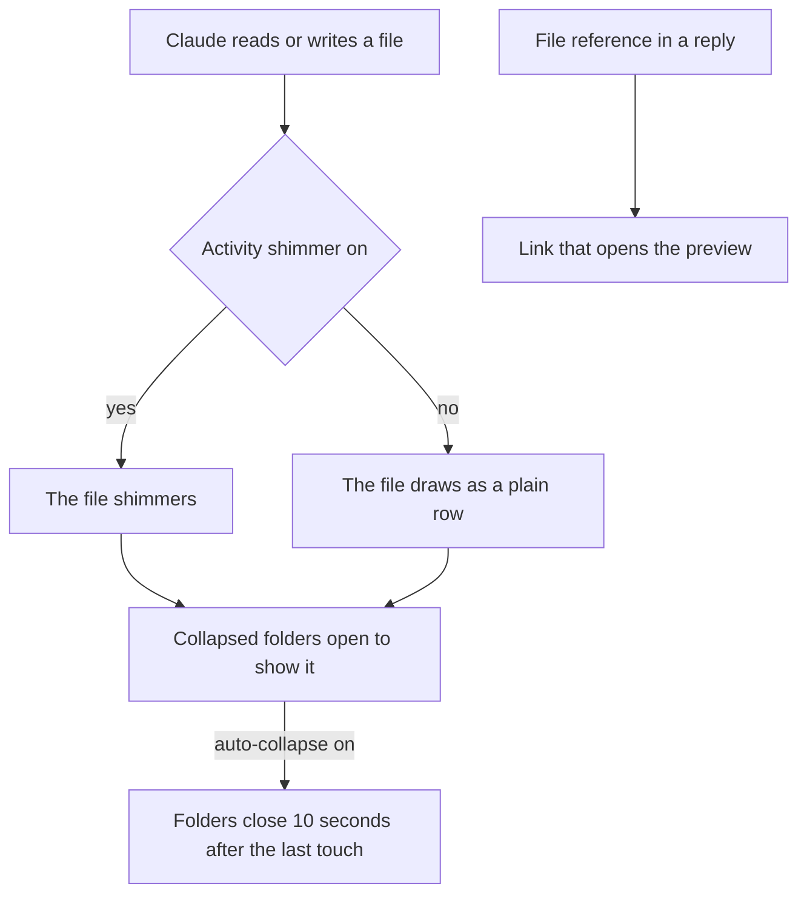

# Claude activity

- Claude's reads (purple), writes (orange) and commits (green) shimmer in the tree; collapsed folders open to show the file
- The Activity shimmer setting (`/config`, under filetree) turns the shimmer off. The Clawd button in the Desktop app header flips the same setting: blue while the shimmer is on, grey while it is off. The terminal has no button and follows the setting, so a choice made in the Desktop app holds in the terminal. With the shimmer off, the files Claude touches draw as plain rows, no rows are pinned above the view and treemap boxes keep their color, but folders still open to show them and Follow Claude still scrolls to them
- A file reference with a line in Claude's reply (`path:12`, `path:12-20` or `path#L12-L20`, relative to the cwd or absolute) to a file under the tree root gets a link under the reply; clicking it reveals the file and opens the preview at that line
- Auto-collapse (`a`, the toolbar button or the setting) closes folders opened for Claude 10 seconds after its last touch; turning it on also closes the ones it opened while off

Follow work moves the session to where the work is. When Claude or its subagents read and write in another git repo for a few minutes (two or more writes there, or four reads with no writes, and clearly more than anywhere else), filetree runs `/cd` to that repo at the end of the turn, or right away while Claude is idle, and the tree follows. It moves at most once every two minutes, stays put while several repos are equally busy, and skips temp folders, `~/.claude`, `~/.config`, `~/Library` and the agents vault. A `z` jump counts as a move, so it is not undone straight away. Where the app has no `/cd` (the Desktop app) or Jump moves Claude is set to tree, only the tree moves: it stays on the repo it shows while the work stays there, and moves back when the work goes back to the first repo.
