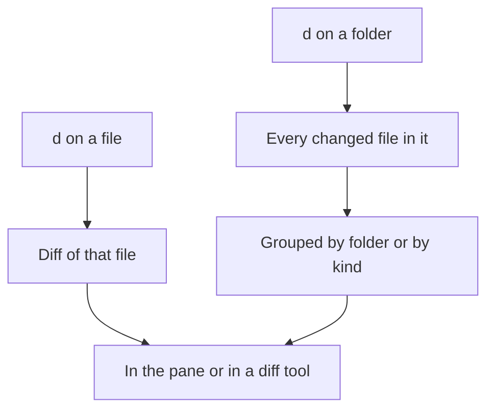
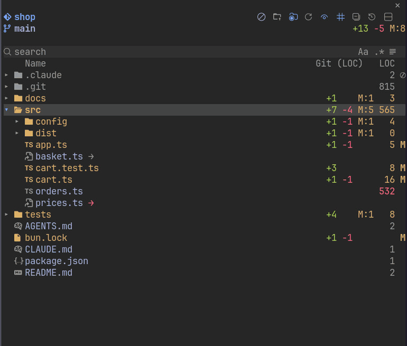

# Diff

- `d` shows the diff of a file or of every changed file in a folder, in the pane or in a tool you name; a folder's files are grouped by folder, with test, build and generated files (lockfiles, `dist`, `build`, `out`, `*.min.*`, snapshots, test folders and `*.test.*` / `*_test.*` files) in a group of their own after the rest

