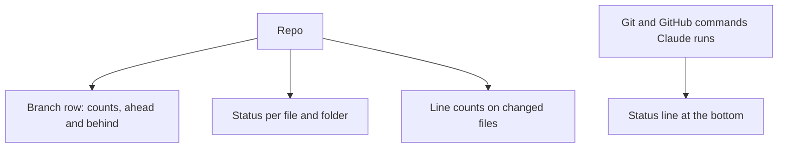

# Git

- Git status per file and folder, line counts on changed files, and the branch with ahead/behind in the header (the upstream name with the `Remote branch` setting)
- Git and GitHub commands Claude runs show as a status line at the bottom of the pane

