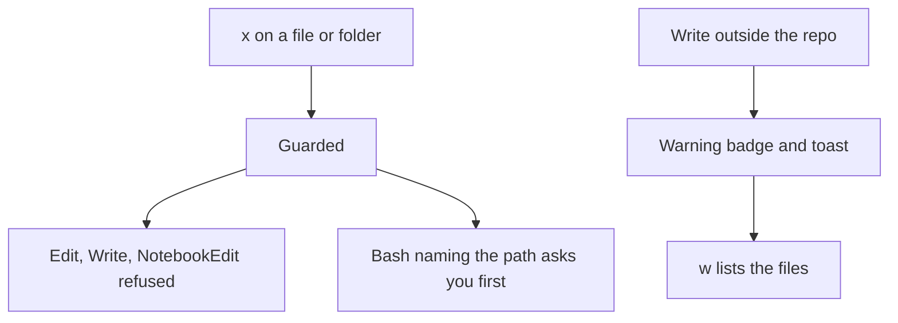

# Guards and outside writes

- `x` guards a file or folder: it draws a red x, and Claude's Edit, Write and NotebookEdit calls on it or anything under it are refused with a reason naming the guard. A Bash or PowerShell command whose text names a guarded path asks you first; that check reads only the command text, so it can miss a path the command builds itself. Guards are kept per repo in filetree's own store under your Claude configuration, never in the repo
- When Claude or a subagent writes a file outside the repo (or outside the tree root when there is no repo) with Edit, Write or NotebookEdit, a warning badge with the count shows in the header and a toast says so the first time in a session; the badge or `w` lists those files. Writes from Bash are not counted, since a shell command's targets cannot be known for sure
