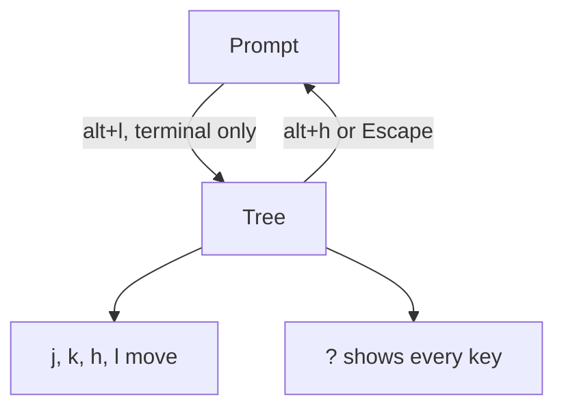
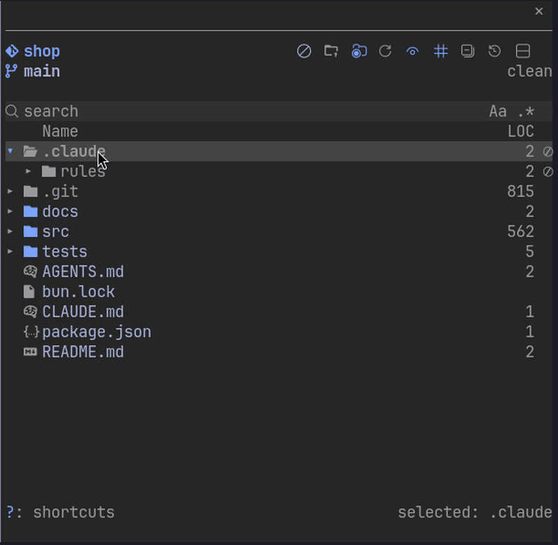

# Keys



With the tree focused:

```yaml
j / k:        move down / up; k on the first row selects the root
h / l:        collapse or go to parent / expand
o, Enter:     open a file or toggle a folder
s:            focus search
i:            search in the folder under the cursor (Backspace on an empty query or × drops it)
z:            jump to a folder, zoxide style: type fragments in order (the last one in the folder name), up/down to pick, Enter re-roots and moves Claude there with /cd, Esc cancels
c / r:        search: match case / regular expression (Aa / .* in the search row)
q:            search: file contents instead of names (the contents toggle in the search row); j / k pick a match, Enter opens it
a:            auto-collapse: close folders opened for Claude 10 seconds after its last touch; turning it on also closes the ones it opened while off
n / g / m:    sort by name / git changes / value column: desc, asc, off (or click the header)
p:            show or hide the preview or treemap
f / b:        scroll the preview a page
"[ / ]":      previous / next page of a PDF or Word document
d:            diff of the entry under the cursor
t:            open a shell in the folder under the cursor (or the file's folder) in a new tmux or herdr pane
x:            guard or unguard the entry under the cursor (off limits to Claude's edits)
w:            list the files Claude wrote outside the repo this session (shown once there are any)
y / Y:        copy the relative / absolute path, or of every marked entry, one per line
u:            copy the file name, or the names of every marked entry
v / V:        mark or unmark the entry under the cursor / clear all marks; in the Desktop app V arrives as v, so press the "N marked" count in the footer to clear them
shift+j / k:  mark the entry under the cursor, move down / up and mark the next one; shift+down / shift+up do the same
shift+click:  mark every entry from the last marked or clicked one to the clicked one, in tree order
ctrl+click:   open the file
"?":          show or hide every key, grouped, over the tree (the Shortcuts button in the Desktop app); j, k, the arrows, f, b, Page Up/Down, Home and End scroll it, and any other key that acts closes it first (? typed in the search field is just a character)
Space:        Quick Look on macOS
```

In the Desktop app the tree's hidden hotkeys lose shift, so shift+j there moves without marking. Click a row first: shift+click and shift+arrows on a clicked row mark ranges.



Resize the pane with the mouse or the `pane:grow` and `pane:shrink` keybindings.

`/filetree keys` adds alt+l (keys from the prompt to the tree) and alt+h (keys back to the prompt) to your `keybindings.json` after asking. They work in the terminal only: the Desktop app does not read `keybindings.json`. It keeps your other bindings, asks before replacing one of yours on the same key (a Global alt+l counts too), keeps the file's indentation, and leaves a file it cannot parse or write untouched.
