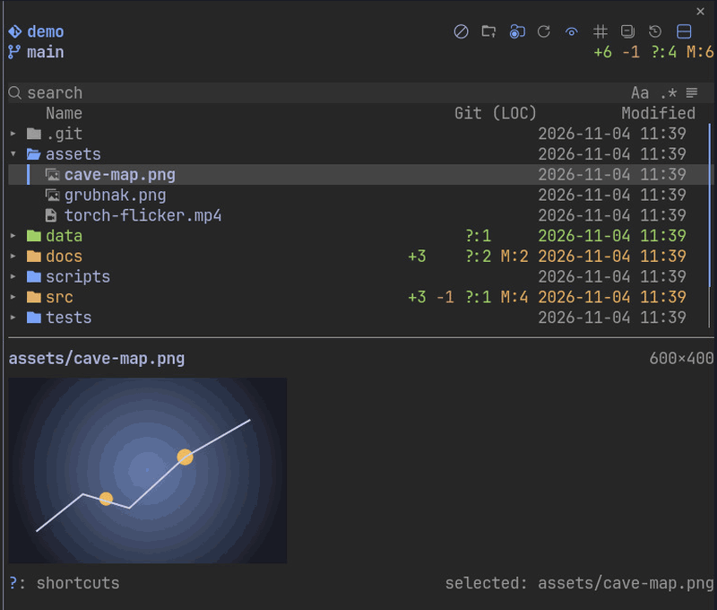
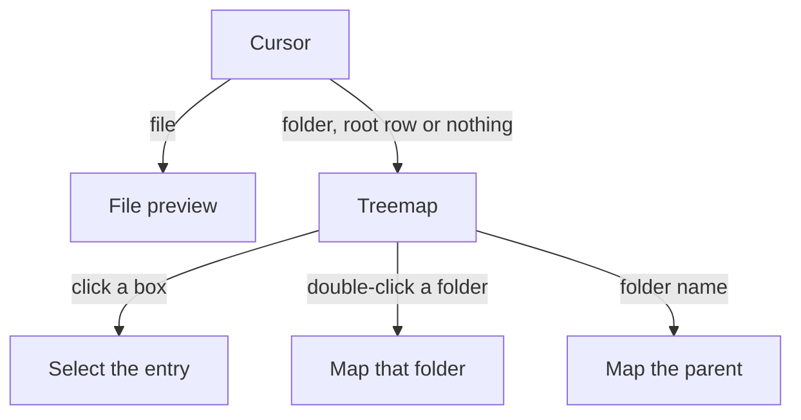
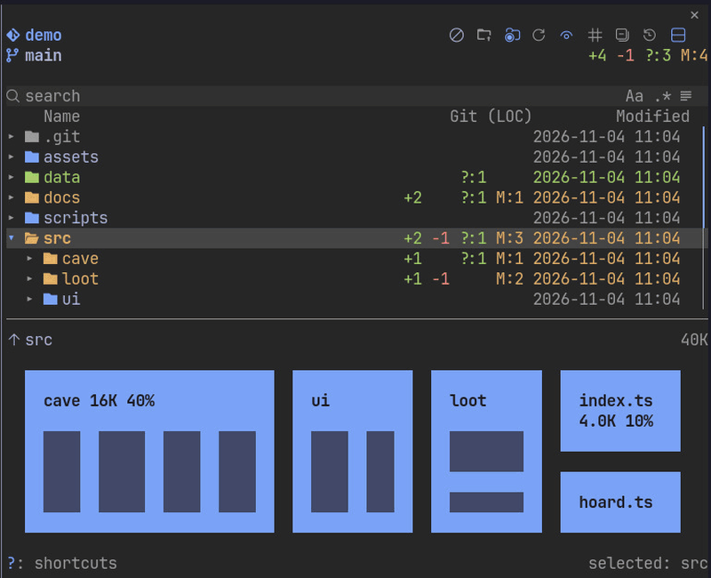
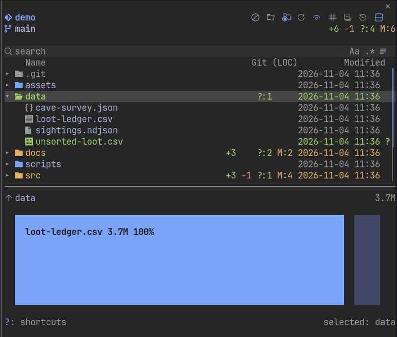

# Preview and treemap

`p` or the header button shows the split. On a file it shows the file; on a folder, the root row or nothing it shows the treemap.

- Split preview under or above the tree: highlighted code, rendered Markdown, images, video poster frames, and PDF and Word pages turned with `[` and `]`
- Treemap of the folder under the cursor in the same split, sized by bytes or by lines, with Claude's activity lit
- The Desktop app has no split preview or treemap
