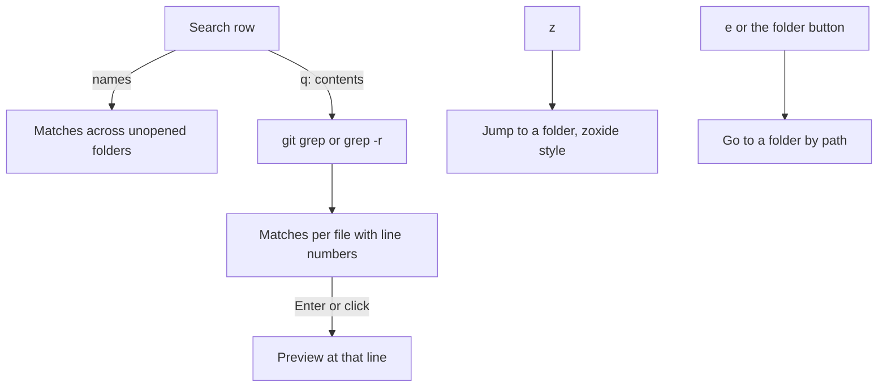

# Search

- The contents toggle in the search row (`q` from the tree, or a click on it) searches inside files instead of names, with `git grep` in a repo and `grep -r` outside one; matches are grouped per file with line numbers, the first 200 are shown (fewer in the Desktop app when lines are long), and Enter or a click opens the file in the split preview at that line (the full preview in the Desktop app)
- `s` focuses search, `i` searches in the folder under the cursor, `c` and `r` match case and regular expressions
- `z` jumps to a folder, zoxide style: type fragments in order, pick with up and down, and Enter re-roots the tree and moves Claude there with `/cd` where the app has `/cd` (the Desktop app does not)
- `e`, or the folder button left of the search field, opens a path field in place of search, filled with the tree root:
  - `~` is your home folder, and a relative path starts at the tree root
  - The rows list the subfolders of the folder typed so far, at most 50
  - Tab completes a folder name, and up and down pick a row
  - Enter re-roots the tree on that folder, adds it to the `z` list, and moves Claude there with `/cd` where the app has `/cd` (the Desktop app does not)
  - A path that does not exist or is a file shows a note under the field and keeps it open
  - Esc closes the field
