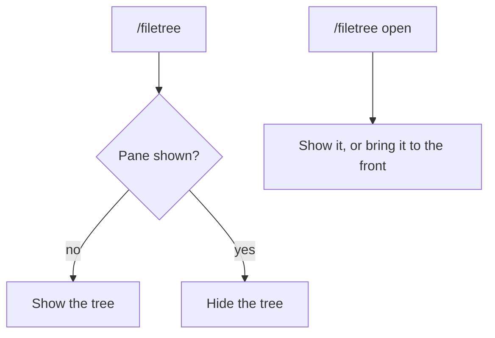

# Sidebar

filetree is a Claude Code **mod** and needs **Claude Code 2.1.306+**.

- It shows in the right sidebar. In the terminal it needs the fullscreen layout (`/tui fullscreen`) and a terminal at least 110 columns wide; the Desktop app docks it on its own
- `/filetree` shows or hides it, also while Claude is working
- `/filetree open` opens it, or brings it forward from behind another tab, without hiding it
- `/filetree keys` binds alt+l and alt+h to move the keyboard to and from the tree, in the terminal only; see [Keys](keys.md)
- `/filetree <path>` pins the tree to a folder
- Tested on Linux, macOS and Windows; mods don't load in WSL sessions of the Desktop app
