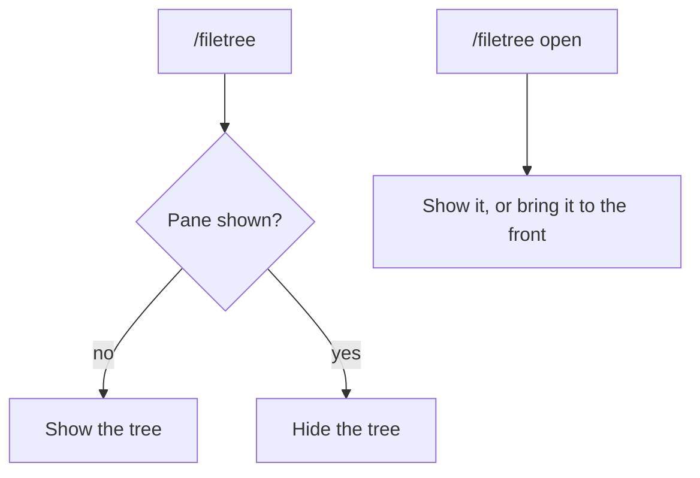

# Sidebar

filetree is a Claude Code **mod** and needs **Claude Code 2.1.306+**.

- It shows in the right sidebar. In the terminal it needs the fullscreen layout (`/tui fullscreen`) and a terminal at least 110 columns wide; the Desktop app docks it on its own
- With the sidebar open the transcript no longer spans the terminal, so Claude Code redraws it cell by cell as it scrolls. A text-style emoji followed by the VS16 selector (`➡️`, `⚠️`, `✔️`) is two cells to Claude Code but one cell to terminals that ignore the selector, such as WezTerm and Alacritty by default, and that mismatch left stray letters in the transcript. In the terminal filetree drops the selector from Claude's replies, so these draw one cell wide in their text style; color emoji such as `❓` and `⭐` are unchanged
- `/filetree` shows or hides it, also while Claude is working
- `/filetree open` opens it, or brings it forward from behind another tab, without hiding it
- `/filetree keys` binds alt+l and alt+h to move the keyboard to and from the tree, in the terminal only; see [Keys](keys.md)
- `/filetree <path>` pins the tree to a folder
- Tested on Linux, macOS and Windows; mods don't load in WSL sessions of the Desktop app

## In a pane-grid cell

[pane-grid](https://github.com/hwanyong/pane-grid) splits a Claude Code pane into cells. With both installed, empty cells list filetree, and `/grid place filetree` draws the tree in the active cell.

- Terminal only; the Desktop app keeps the tree in its own pane
- While placed, the Files tab closes; it opens again when the cell is emptied with `/grid place -`
- The fullscreen layout and the 110-column width are not needed in a cell
- `/filetree` and `/filetree <path>` change the tree in the cell and do not hide it
- The wheel scrolls the tree under its header with pane-grid 0.4.0 or later; an older pane-grid scrolls the whole cell
- alt+l and the other keys that move the keyboard to the tree do nothing while placed, because filetree cannot focus pane-grid's pane; click the cell instead
