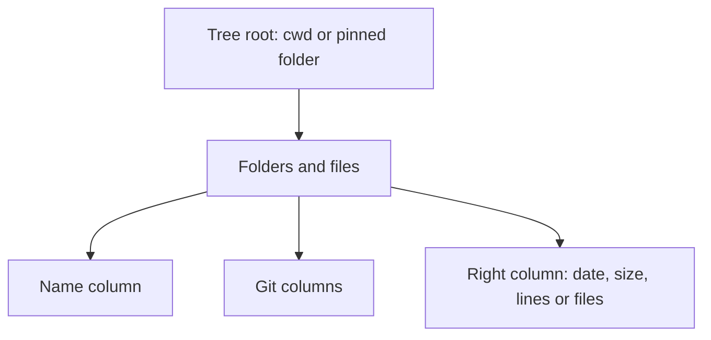
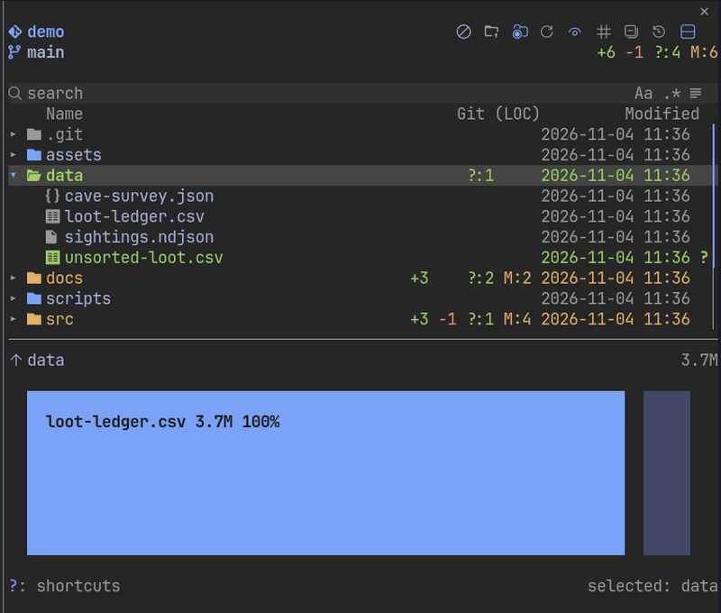
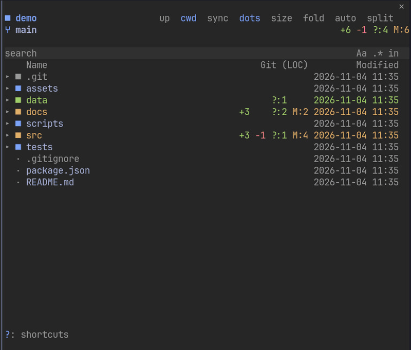

# File tree

- File tree of the cwd, or of a folder pinned with `/filetree <path>`, with search across unopened folders, case-sensitive or by regular expression, scoped to one folder, with the matched characters highlighted in each result, and sortable Name, Git and value column headers
- Right column cycles date, size, lines of code and number of files from the header button, with git counts in their own columns beside it; a folder's date is its newest file, written year-month-day, day-month or month-day on a 24h or 12h clock by the Date format and Clock settings
- The collapse button closes every folder; when every folder is closed it becomes expand all, which opens up to three levels and at most 150 folders, skipping `.git`
- Symlinks show an arrow after the name: muted when the target is in the tree, yellow when it is outside, red when it is missing or the link is circular; the footer names the target and which of these it is for the selected row
- `AGENTS.md`, `CLAUDE.md`, their `.local.md` variants and Markdown files under any `.claude/rules/` folder draw a brain instead of the Markdown icon (`§` in plain glyphs)
- Draws in the terminal's own palette, with Nerd Font, plain or text glyphs; in the Desktop app, vector icons for files, folders and the toolbar
- Changes made outside Claude show at once on Linux through `inotifywait`

